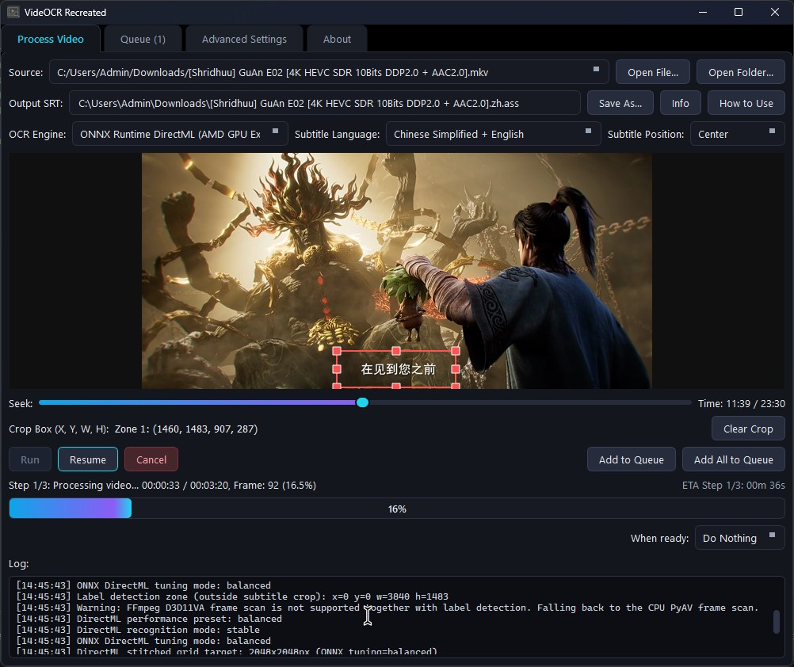

<p align="center">
  
  <h1 align="center">VideOCR Recreated</h1>
  <p align="center">
    Extract hardcoded subtitles from videos with a modern PySide6 GUI, 200+ languages, and experimental AMD DirectML GPU support.
    <br>
    <em>Forked from <a href="https://github.com/timminator/VideOCR">VideOCR</a> (by <code>timminator</code>), via <a href="https://github.com/BaseCrunch/VideOCR-AMD-DirectML">VideOCR-AMD-DirectML</a> (by <code>BaseCrunch</code>).</em>
  </p>

  <p align="center">
    <a href="https://github.com/FlamingWater35/VideOCR-Recreated/releases">
      
    </a>
  </p>

  <p align="center">
    
    
    
    
  </p>
</p>

---

<p align="center">
  
  <br />
  <em>VideOCR Recreated main window</em>
</p>

---

## 📑 Table of Contents

- [✨ About & Key Features](#-about--key-features)
- [⚙️ Settings Reference](#️-settings-reference)
- [🚀 Quick Setup](#-quick-setup)
  - [📦 Pre-built Releases](#-pre-built-releases-recommended)
  - [💻 Development Setup (From Source)](#-development-setup-from-source)
  - [🔨 Building Standalone Executables](#-building-standalone-executables)
- [🎯 Usage Examples](#-usage-examples)
- [⚡ Performance & Tuning](#-performance--tuning)
- [🛠️ Troubleshooting](#️-troubleshooting)
- [🙏 Credits](#-credits)
  - [🌐 Translating the subtitles](#-translating-the-subtitles)

---

## ✨ About & Key Features

VideOCR Recreated extracts hardcoded/burned-in subtitles from videos and exports them as `.srt` (or `.ass` with label detection) files. It builds upon previous forks to deliver a polished, feature-rich experience:

- **Modern PySide6 GUI**: A complete rewrite featuring a warm-obsidian & gold dark theme, native HiDPI support, resizable layouts, and persistent settings.
- **Label Detection**: Detects text *outside* the subtitle crop area (e.g., character/place names) and exports positioned `.ass` subtitle files with auto-fixing.
- **AMD DirectML Support**: Experimental hybrid GPU acceleration for Windows (DirectML text detection + CPU recognition fallback for maximum stability).
- **ONNX Runtime DirectML**: Experimental unified RapidOCR backend with PP-OCRv6 models for higher accuracy.
- **Refined FFmpeg Path**: Uses `-fps_mode vfr` for seamless compatibility with newer FFmpeg versions.
- **Streamlined Experience**: Removed GUI benchmarking buttons (CLI benchmark tools remain available for advanced users). Update checks are folded into the About tab, which flags new releases and links straight to them.

---

## ⚙️ Settings Reference

A quick guide to the most important GUI and CLI parameters to help you balance speed and accuracy.

<details>
<summary><strong>📋 Click to expand the full settings table</strong></summary>

<br>

| Setting | Description | Tuning Tip |
| :--- | :--- | :--- |
| **Frames to Skip** | Number of frames to skip before sampling for OCR. | **Higher** = faster processing. **Lower** (or `0`) = more accurate timestamps. |
| **OCR Image Max Width** | Downscales the cropped image before passing it to OCR. | **Lower** (e.g., `720`) = faster. **Higher** (e.g., `960`) = better for small text. |
| **SSIM Threshold** | Structural similarity threshold for frame deduplication. | **Lower** (e.g., `85`) = skips more similar frames (faster). **Higher** (e.g., `92`) = safer, processes more frames. |
| **Confidence Threshold** | Minimum confidence score for word predictions. | **Lower** = catches more words (but more typos). **Higher** = stricter, fewer false positives. |
| **OCR Model Tier** | PP-OCRv6 model size used for detection and recognition. | `Tiny` = fastest, lowest accuracy. `Small` (default) = balanced. `Medium` = most accurate, noticeably slower and hungrier for VRAM. Applies to the PP-OCRv6 engines (PaddleOCR, ONNX Runtime DirectML, and the Google Lens detection pass); EasyOCR is the internal fallback and has no tiers. All three tiers ship with the app, so switching never downloads anything. |
| **Max Merge Gap** | Max time gap (in seconds) to merge similar subtitle lines. | Increase (e.g., `0.3`) if your output has fragmented or repeated lines. |
| **Crop Area** | Bounding box (X, Y, Width, Height) for OCR. | Keep it **tight** around the subtitles. Avoid full-frame OCR unless absolutely necessary. |
| **Full Frame** | Forces OCR on the entire video frame instead of the crop. | Generally **unchecked**. Slower and less accurate; only use if subtitles move wildly. |
| **Enable Label Detection** | Detects text outside the crop (e.g., names) and exports as `.ass`. | Adds valuable context but requires extra processing. Auto-runs `ass-qafix` post-processing. |
| **Separate Label Files** | Writes subtitles and labels as two `.ass` files instead of one combined file. | Subtitles keep the output path you chose; labels go to a `<name>.labels.ass` companion file. Handy when you want to translate, restyle or toggle the labels independently of the dialogue. |
| **DirectML Perf. Preset** | Controls the stitched grid target size for AMD GPUs. | `Compatibility` (1600x1600), `Balanced` (2400x2400, recommended), `Max` (4096x4096). |
| **DirectML Rec. Mode** | How text recognition is handled on AMD GPUs. | **`Stable`** (GPU detection + CPU recognition, safest). `Auto`/`Experimental` may crash on some models. |
| **DirectML Frame Scan** | How frames are pre-processed before OCR. | `CPU SSIM` (compatible), `AMD DirectML SSIM` (experimental), `FFmpeg D3D11VA` (prototype, fastest). If a mode cannot start, the app falls back automatically — FFmpeg → DirectML SSIM → CPU SSIM — and logs why. |
| **FFmpeg** | The binary used by the `FFmpeg D3D11VA` frame scan. | DirectML builds ship a managed copy that takes precedence over any `ffmpeg` on `PATH`. *Check for Updates* compares it against the newest release and *Update FFmpeg* replaces it in place — no restart needed, since the next run resolves the new binary. |
| **DirectML Grid Max W/H** | Manual override for stitched OCR grid size. | Larger values reduce per-image overhead but use more VRAM. |

</details>

---

## 🚀 Quick Setup

### 📦 Pre-built Releases (Recommended)

Get started instantly by downloading the latest installer or portable folder from the [Releases page](https://github.com/FlamingWater35/VideOCR-Recreated/releases).

- **Windows**: Run the setup installer or unzip the portable folder to your desired location.
- **Linux**: Download the tarball, unzip, and optionally run `./install_videocr.sh` to create a desktop shortcut.

### 💻 Development Setup (From Source)

*Requires **Python 3.12** (Python 3.13 is not recommended due to `torch-directml` wheel compatibility).*

**Windows (AMD DirectML):**

```bat
py -3.12 -m venv .venv --upgrade-deps
call .venv\Scripts\activate.bat
python -m pip install --upgrade pip setuptools wheel
python -m pip install -e ".[directml]"
python -m pip install --force-reinstall --no-cache-dir "sympy==1.13.3" "mpmath==1.3.0"
python VideOCR_qt.py
```

**Windows / Linux (NVIDIA CUDA):**

```bash
python -m venv .venv
source .venv/bin/activate  # Windows: call .venv\Scripts\activate.bat
python -m pip install --upgrade pip setuptools wheel
python -m pip install -e .
# Build CUDA helpers: python build.py --target gpu-cuda12.9
python VideOCR_qt.py
```

> **Note:** NVIDIA users should use the normal CUDA builds. The DirectML path is strictly intended for AMD GPUs on Windows.

### 🔨 Building Standalone Executables

To compile portable releases (requires C++ Build Tools on Windows and 7-Zip):

```bash
git clone https://github.com/FlamingWater35/VideOCR-Recreated.git
cd VideOCR-Recreated
pip install . --group all
# Build targets: cpu, gpu-cuda11.8, gpu-cuda12.9, gpu-directml, or all
python build.py --target gpu-directml --clean true
```

---

## 🎯 Usage Examples

### GUI Workflow

1. Import a video and seek using the timeline or arrow keys.
2. Draw a crop box over the subtitle area (click and drag).
3. Adjust settings using the **Settings Reference** table above.
4. Click **Run** to start extraction.

### CLI Workflow

Run `videocr-cli.exe -h` (or `python CLI\videocr_cli.py -h`) for a full list of parameters.

**Windows Executable Example:**

```bat
.\videocr-cli.exe --video_path "video.mp4" --output "output.srt" --lang en --use_gpu true
```

**AMD DirectML Source Example:**

```bat
set VIDEOCR_DIRECTML_DEVICE_INDEX=1
python CLI\videocr_cli.py --video_path "video.mp4" --output "output.srt" --ocr_engine easyocr_directml --lang en --use_gpu true --use_fullframe false
```

---

## ⚡ Performance & Tuning

| Mode | Best For | Notes |
| :--- | :--- | :--- |
| `paddleocr` (CPU) | Compatibility | Fully local, but can be slow. |
| `paddleocr` (CUDA) | NVIDIA GPUs | Fastest official local GPU path. |
| `google_lens` | Accuracy | Requires internet; hybrid cloud recognition. |
| `easyocr_directml` | AMD Windows GPUs | Experimental hybrid DirectML mode. |

### AMD DirectML Tuning Tips

- **Expected GPU Usage**: 10–40% is normal. The pipeline bursts: CPU filters/stitches frames → GPU detects text → CPU recognizes/merges.
- **Discrete GPU Selection**: If workloads land on your iGPU, set the environment variable `VIDEOCR_DIRECTML_DEVICE_INDEX=1`, or select `GPU 1` in the GUI Advanced Settings (this preference is saved automatically).
- **Windows Graphics Preference**: If needed, force Windows *Settings → System → Display → Graphics* to "High performance" for `.venv\Scripts\python.exe`.

---

## 🛠️ Troubleshooting

- **`No module named av` / `PySide6`**: Ensure you ran `pip install -e ".[directml]"` inside your activated virtual environment.
- **`No module named sympy.core`**: Run `pip install --force-reinstall --no-cache-dir "sympy==1.13.3" "mpmath==1.3.0"`.
- **DirectML using Integrated GPU**: Force Windows *Graphics Settings* to "High performance" for the Python executable, or set the device index as noted above.
- **ONNX DirectML `DmlExecutionProvider` not found**: Uninstall `onnxruntime` and install `onnxruntime-directml` instead. They cannot coexist in the same environment.
- **EasyOCR DirectML LSTM Crash**: This is a known operator compatibility issue. Ensure Recognition Mode is set to `Stable` to utilize the CPU fallback safely.

---

## 🙏 Credits

This project is a **fork of a fork**, building upon the excellent work of:

1. **[VideOCR](https://github.com/timminator/VideOCR)** by `timminator` (The base subtitle-extraction project).
2. **[VideOCR-AMD-DirectML](https://github.com/BaseCrunch/VideOCR-AMD-DirectML)** by `BaseCrunch` (Added the AMD DirectML backend, GPU selection, performance presets, and D3D11VA frame-scan).

This recreation adds the PySide6 GUI, Label Detection, ONNX DirectML support, and further refinements for a modern user experience.

## 🪪License

[](https://github.com/FlamingWater35/VideOCR-Recreated/blob/main/LICENSE)

### 🌐 Translating the subtitles

VideOCR extracts the subtitles; it does not translate them. If you're looking for translating subtitles (especially for donghua),
**[Polygluttony](https://github.com/blyat-uk/polygluttony)** is recommended. It's a desktop app that translates `.ass` subtitle files with the AI model
of your choice (Anthropic, OpenAI, Google, or a local model via Ollama / LM Studio).

It is a particularly good match for files this tool produces:

- **Your typesetting survives.** Override tags such as `{\pos(...)}` and `{\anN}` are
  lifted out before translating and put back afterwards, so the positioned **Label**
  events keep their on-screen placement and only the dialogue text changes.
- **Names stay consistent.** A cross-episode glossary keeps character and place names
  stable across a whole season.
- **Nothing is silently lost.** Line markers and drift detection catch dropped, merged
  or reordered lines instead of failing a whole batch.

Thanks to `BuGiPoP` on Discord for building such a great tool.
